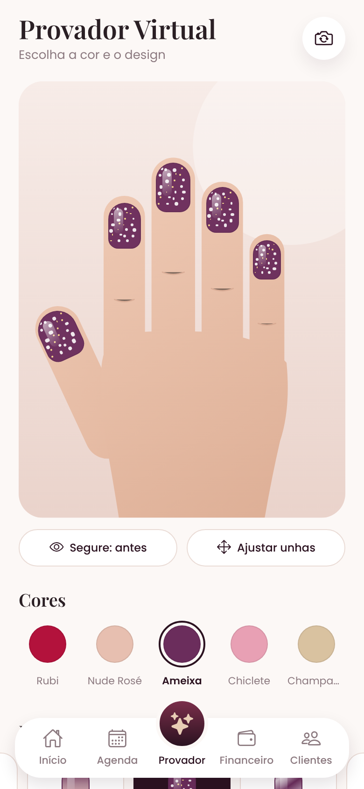

# Cores & Fios

App para manicures (Android e iOS) feito com **Expo / React Native** e **Expo Router**.

 

## Módulos

| Módulo | Status |
| --- | --- |
| Página inicial (faturamento, meta do mês, próximos horários, avaliações) | ✅ Pronto |
| Agenda de clientes | ✅ Pronto |
| Financeiro | ✅ Pronto |
| Ajustes do studio | ✅ Pronto |
| Provador Virtual (foto da mão + teste de esmaltes e designs) | ✅ Pronto |
| Clientes: cadastro rápido e Premium com programa fidelidade | ✅ Pronto |
| Avaliações com foto, estrelas e opção anônima | ✅ Pronto |

## Provador Virtual

1. A cliente tira uma foto da mão (ou escolhe da galeria) — ou usa a **mão de exemplo**.
2. Toca sobre cada unha para marcá-la; pode arrastar, aumentar, alongar e girar cada uma.
3. Escolhe entre 15 cores, 8 designs (tradicional, gel, matte, francesinha, baby boomer, glitter, cromado e nail art poá) e 6 formatos (natural ou alongamento quadrado, redondo, amendoado, bailarina e stiletto), com o preço de cada serviço.
4. Pode decorar uma **unha de destaque** (+R$ 15), segurar o botão para ver o **antes**, salvar looks para comparar e tocar em **Agendar** para levar o serviço escolhido à agenda.

Preços, cores e formatos ficam em `src/data/catalog.ts`.

### Realismo

O esmalte é desenhado em SVG (`src/features/nails/`) no contorno do formato escolhido e recebe a luz da foto: um filtro passa-alta compara cada ponto da unha real com a vizinhança e transfere reflexos e sombras para o esmalte, sem mudar o tom do vidro. Somam-se curvatura lateral, sombra na cutícula, borda e o brilho do top coat. Os acabamentos foram calibrados comparando com fotos reais de unhas feitas (Open Images, CC BY 2.0, usadas só como referência visual): reflexo em faixa ao longo da unha e curvo na ponta no gel, glitter fino e iridescente com poucas lascas maiores, cromado com faixas no sentido do comprimento e matte sem reflexo. Sobre o alongamento (fora da unha real) a luz da foto some em degradê.

## Agenda

- Faixa de dias com marcação de quantos horários há em cada um; dias fechados aparecem apagados.
- **Novo agendamento**: cliente cadastrada (com alerta de alergia e preferências) ou avulsa (pode virar cadastro rápido), serviço com duração e preço (`src/data/services.ts`), desconto de aniversário para Premium e **só os horários livres**, calculados pela duração do serviço, pelo horário de funcionamento e pelos horários já ocupados.
- No horário: confirmar presença, pedir confirmação ou lembrete no **WhatsApp**, remarcar, cancelar ou marcar falta.
- **Concluir atendimento** registra o pagamento (Pix, dinheiro, débito ou crédito), lança a entrada no financeiro e, se a cliente for Premium, dá o selo do cartão fidelidade.
- O look montado no Provador vai direto para o agendamento com o valor calculado.

## Financeiro

- Lucro do mês, entradas, saídas e progresso da meta mensal; atendimentos concluídos, ticket médio e faltas.
- Gráficos: entradas por dia, entradas por forma de pagamento e saídas por categoria (cores validadas para daltonismo e contraste), e ranking dos serviços que mais faturaram.
- Lançamentos manuais de despesas e outras entradas, com filtro e exclusão.

## Ajustes

Nome da profissional e do studio, meta do mês, horário de funcionamento, dias de atendimento, intervalo entre horários e a opção de apagar todos os dados do aparelho.

## Avaliações

Na página inicial, **Avaliar meu atendimento** abre o formulário: foto do resultado (câmera ou galeria), nota de 1 a 5 estrelas, serviço realizado, comentário e a escolha entre publicar **com o nome** ou como **anônima**. A lista mostra a média, a distribuição das notas e filtros (com foto, 5 estrelas); a profissional pode remover uma avaliação.

## Cadastro de clientes

Campos escolhidos a partir do que sistemas de agendamento de salão e fichas de manicure costumam pedir. **O app não pede documentos (CPF etc.)**: a cliente se identifica só pelo WhatsApp, confirmado com um código de 6 dígitos (`src/features/verification/`). Nesta versão, sem servidor, o código é gerado no aparelho e mostrado na tela; ao ligar um servidor, ele passa a ser enviado pela API do WhatsApp Business (ou SMS) sem mudar as telas.

| | Rápido | Premium |
| --- | --- | --- |
| Para quem | Agenda de vez em quando | Cliente recorrente |
| Dados | Nome e WhatsApp | Nome e WhatsApp; e-mail, nascimento (desconto de aniversário) e endereço (domicílio) opcionais; canal de contato |
| Validação | Código pelo WhatsApp | Código pelo WhatsApp |
| Preferências | – | Formato, comprimento, até 5 cores favoritas, melhores horários, como conheceu / quem indicou |
| Ficha de saúde | – | Alergias, condições (diabetes, circulação, gestante, anticoagulante, unhas frágeis, micose) e observações — só salva com autorização específica (dado sensível pela LGPD) |
| Fidelidade | – | Cartão de 10 selos = 1 esmaltação em gel grátis, selo de boas-vindas, 15% no mês do aniversário, +2 selos por indicação, níveis Rosé, Ouro e Diamante |

O cadastro rápido pode virar Premium aproveitando os dados. No perfil, a profissional registra atendimentos (+1 selo), bônus de indicação e o resgate do prêmio; a cliente pode editar ou excluir o cadastro. Regras da fidelidade em `src/data/loyalty.ts`.

Os dados ficam salvos **no aparelho** (AsyncStorage; fotos na pasta de documentos do app). Para clientes e profissional compartilharem os mesmos dados entre celulares, o próximo passo é um backend (ex.: Supabase ou Firebase).

## Como rodar

```bash
npm install
npx expo start
```

Depois, escaneie o QR Code com o app **Expo Go** (Android ou iPhone), ou pressione `a` (emulador Android) / `i` (simulador iOS).

Antes de enviar mudanças:

```bash
npx tsc --noEmit
npx expo lint
```

## Página de teste

Gera o app inteiro (versão web) num único arquivo HTML, com roteiro do que testar e dados de exemplo (clientes fictícias, um mês de atendimentos e despesas, datas relativas ao dia em que for aberta):

```bash
python3 tools/pagina-de-teste/build.py          # saída: dist-teste/cores-e-fios-teste.html
node tools/pagina-de-teste/smoke.js             # percorre o app e falha se algo quebrar (Playwright)
```

Para usar uma foto real de mão no Provador, coloque a foto (3:4) e a posição das unhas em `tools/pagina-de-teste/local/` (ignorada pelo Git) e rode `build.py --foto local/mao.jpg --unhas local/unhas.json`.

## Publicar nas lojas

Ícone, ícone adaptativo do Android, tela de abertura e favicon são gerados por `python3 tools/brand/generate_icons.py`. O build é feito na nuvem pelo EAS (não precisa de Mac nem Android Studio):

```bash
npx eas-cli@latest login
npx eas-cli@latest build --profile preview --platform android     # APK para instalar e testar
npx eas-cli@latest build --profile production --platform all      # versões para Google Play e App Store
npx eas-cli@latest submit --platform all                          # envia para as lojas
```

Antes de publicar:

- Contas de desenvolvedor: Google Play (taxa única) e Apple Developer (anual).
- Hospedar `docs/politica-de-privacidade.md` (com o nome e o WhatsApp do studio) e informar a URL nas lojas.
- Identificadores do app: `com.coresefios.app` (iOS e Android), em `app.json`.

## O que falta para uso com várias clientes

- **Servidor (ex.: Supabase ou Firebase):** hoje os dados ficam no aparelho onde foram registrados. Com um servidor, a cliente agenda e avalia pelo celular dela e a profissional vê tudo no dela.
- **Envio real do código pelo WhatsApp:** a verificação já está pronta nas telas; falta o servidor chamar a API do WhatsApp Business (ou SMS) em `src/features/verification/whatsappCode.ts`.
- **Provador Virtual:** detecção automática das unhas na foto (hoje a marcação é por toque).

## Estrutura

```
src/
  app/                 # rotas (Expo Router)
    _layout.tsx        # fontes e navegação raiz
    (tabs)/            # abas: início, agenda, provador, financeiro, clientes
    avaliacoes/        # lista e nova avaliação
    cadastro.tsx       # cadastro rápido e Premium (4 passos)
    cliente/[id].tsx   # perfil com cartão fidelidade e histórico
    agendamento/       # novo agendamento e detalhe do horário
    financeiro/novo.tsx # novo lançamento
    ajustes.tsx        # ajustes do studio
    privacidade.tsx    # política de privacidade (LGPD)
  components/          # TabBar, Nail (miniatura de unha), SectionHeader, ui (campos, botões, estrelas)
  features/nails/      # desenho do esmalte em SVG: formatos, designs e acabamento
  features/tryon/      # Provador Virtual: área da foto, mão de exemplo, introdução
  data/catalog.ts      # esmaltes, designs e preços
  data/loyalty.ts      # regras do programa fidelidade
  data/services.ts     # serviços da agenda (preço e duração)
  features/agenda/     # agendamentos, horários livres e componentes da agenda
  features/finance/    # lançamentos e gráficos do financeiro
  features/settings/   # ajustes do studio
  features/verification/ # código de verificação do WhatsApp
  features/clients/    # cadastro de clientes (tipos e armazenamento)
  features/feedback/   # avaliações (armazenamento)
  data/mock.ts         # cores em destaque na página inicial
  theme/               # cores, fontes, raios e sombras
```
